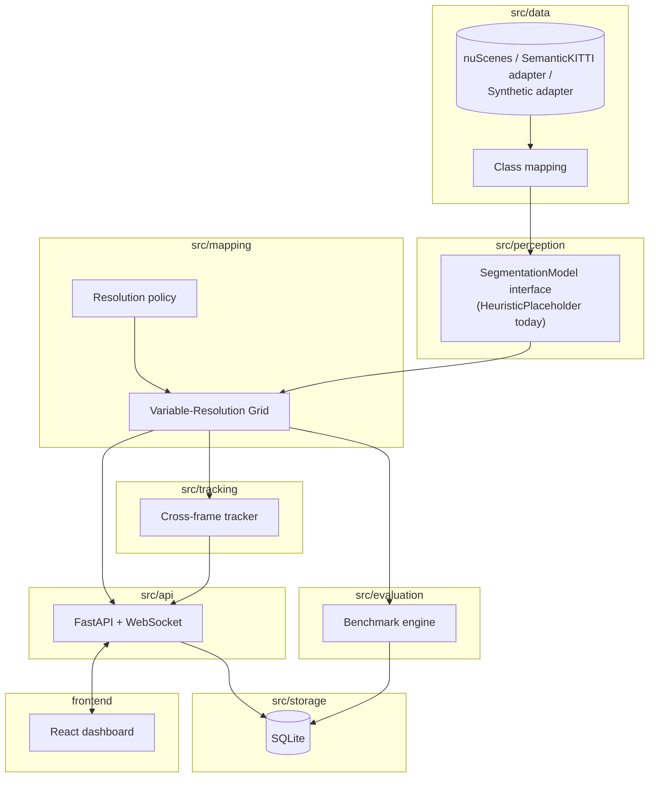
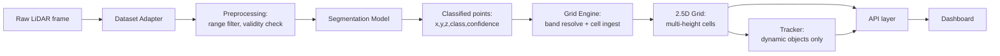
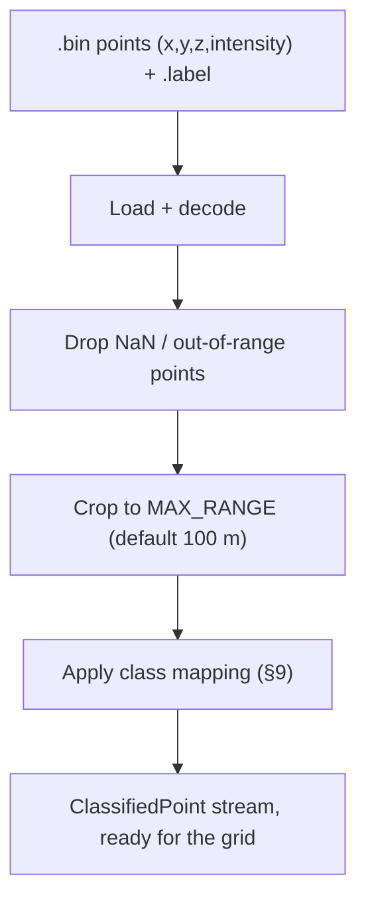
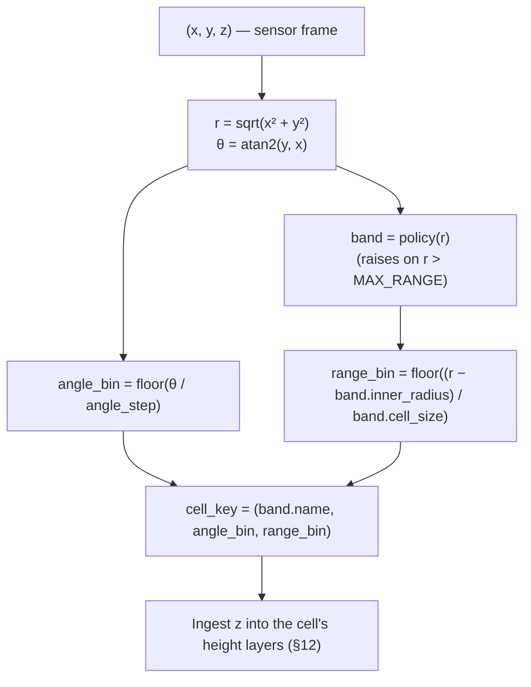
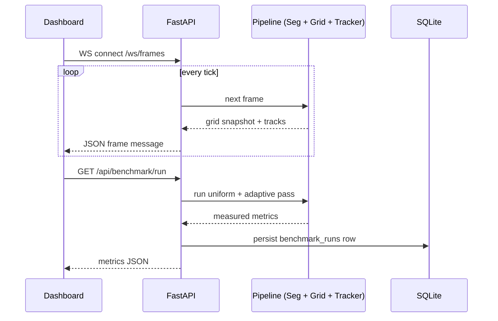
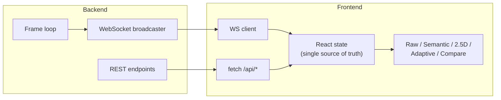
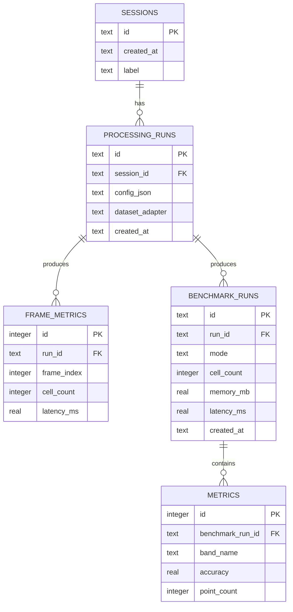
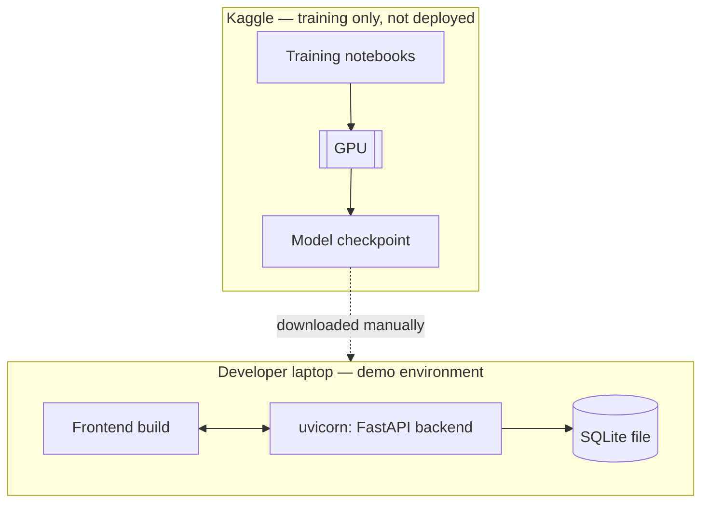

# ARCHITECTURE.md
### FoveaLidar — system design

Companion to PROJECT_REQUIREMENTS.md. This file explains how the system is built; the requirements file explains why.

---

## 1. System overview

Seven modules, each with one job, connected by two fixed interfaces (`DatasetAdapter`, `SegmentationModel`) so any one module can be replaced without touching its neighbours:

`src/data` (dataset adapters + class mapping) → `src/perception` (segmentation interface) → `src/mapping` (the variable-resolution grid engine) → `src/tracking` (cross-frame identity) → `src/evaluation` (benchmark engine) → `src/api` (FastAPI + WebSocket) → `frontend` (React dashboard). `src/storage` sits alongside, persisting run metadata from `api` and `evaluation`.

## 2. Architectural principles

1. **The grid never knows about object identity; the tracker never touches per-cell height data.** Keeping this boundary clean is what stops a tracking bug from corrupting the terrain map, and vice versa.
2. **The model is replaceable without touching the mapping engine.** Everything downstream of segmentation depends only on the `ClassifiedPoint` shape, never on how it was produced.
3. **Resolution is data, not code.** Band boundaries, cell sizes, and layer caps live in configuration; the grid engine is generic over however many bands it's given.
4. **No number is invented.** The benchmark engine measures; it does not estimate anything it could instead run.
5. **Training data preparation and the final mapping representation are different concerns.** A model may train on raw points, voxels, or a range image — whatever the network needs — but the *mapping* stage always outputs the variable-resolution 2.5D structure regardless of what the model consumed internally.

## 3. High-level architecture



## 4. End-to-end data flow



## 5. Dataset adapter (`src/data`)

**Interface:** `DatasetAdapter.frames() -> Iterator[RawFrame]`, where `RawFrame` is `{points: float32[N,4], raw_labels: <dataset-specific>[N] | None, frame_id, sequence_id}`. Each adapter also supplies its own `label_mapper()` — a callable resolving one raw label value to a project-taxonomy string — since different datasets encode raw labels completely differently (§ below); `src/data/base_adapter.py`'s `preprocess_frame` takes this mapper as an explicit parameter rather than assuming one dataset's encoding.

**Implementations:**
- `SyntheticAdapter` — generates a plausible frame procedurally (terrain scatter + fixed static obstacles + moving objects). No download, no license, runs anywhere. Used for development, the automated tests, and the live demo (`src/api/main.py` never touches a real dataset adapter — only the notebooks do).
- `NuScenesAdapter` — **primary as of this build.** Wraps the official `nuscenes-devkit` rather than parsing files by hand (unlike the SemanticKITTI adapter below) — nuScenes' relational, token-linked JSON schema is genuinely impractical to reimplement reliably, which is exactly the kind of complexity a maintained devkit exists to absorb. Verified against the *actual installed* devkit source and a hand-built fixture matching its real table schema (`tests/test_nuscenes_adapter.py`) — every API call cited in the code's comments was confirmed by reading the installed library's source, not just its documentation.
- `SemanticKittiAdapter` — the original primary, kept as a named alternative behind the same interface (switched away from — see rationale below — not deprecated). Reads real SemanticKITTI `.bin`/`.label` pairs directly; documented against the published binary format; verified only against documentation and a hand-built fixture, since no equivalent official Python package exists for raw SemanticKITTI files the way `nuscenes-devkit` exists for nuScenes.

**Why the primary dataset changed from SemanticKITTI to nuScenes-mini:** not a capability judgement — SemanticKITTI remains the better-matched taxonomy (§ table below still shows this). The switch was a practical one: SemanticKITTI's only official distribution bundles all 22 sequences into one 80GB archive with no per-sequence download, which was infeasible to work with here. nuScenes-mini is a ~4GB official subset built by its maintainers specifically for exactly this situation — no comparable "small official slice" exists for SemanticKITTI's *velodyne* data (the 179MB labels-only download is small, but useless without matching point clouds). A selective range-request downloader for SemanticKITTI was also built (`scripts/fetch_semantickitti_sequence.py`, untested against the live server from this sandbox) as an alternative if nuScenes turns out to be the wrong call later.

**Primary dataset rationale — updated comparison:**

| Criterion | SemanticKITTI | nuScenes-mini | KITTI (raw) | Waymo Open |
|---|---|---|---|---|
| Point-wise semantic labels | Yes (34 classes) | Yes, via lidarseg add-on (32 classes) | No | Yes |
| 360° automotive LiDAR | Yes, 64-beam | Yes, 32-beam (fewer points/scan) | Yes | Yes |
| Sequential / temporal | Yes, 10 Hz | Yes, 20 Hz (2Hz keyframes) | Yes | Yes |
| Moving vs. non-moving distinction | Yes, dedicated task | Partial (no equivalent dedicated task) | No | Partial |
| Ground/road classes present | Yes (road, parking, sidewalk) | Yes (driveable_surface, sidewalk) | No | Yes |
| Official small-subset download | **No** — 80GB is the only option | **Yes** — ~4GB `v1.0-mini`, built for this | No | No |
| License | Free for non-commercial research | **Non-commercial only** — flag this before any commercial claim drawn from results | Free for non-commercial research | Free for non-commercial research |
| Laptop/Kaggle feasibility | Poor without a selective downloader | **Good** — the whole point of mini | Good, no labels | Hardest — largest, most complex devkit |

nuScenes-mini wins on the one criterion that actually blocked progress; SemanticKITTI still wins on taxonomy fit and point density per scan, which is exactly why it's kept rather than deleted. Waymo remains a FUTURE validation dataset (PROJECT_REQUIREMENTS.md §22).

**Citation obligation:** Caesar et al., *nuScenes: A Multimodal Dataset for Autonomous Driving*, CVPR 2020 — required in any paper or report drawn from this work, alongside Behley et al. (SemanticKITTI, ICCV 2019) if the alternative path is ever used instead or in addition. Both citations, and the nuScenes non-commercial license term above, belong in the paper's dataset section, not just this file.

## 6. LiDAR preprocessing



`.label` decoding note: SemanticKITTI packs a `uint32` per point — lower 16 bits semantic class, upper 16 bits instance ID — with moving-object classes as separate raw IDs from their static counterparts (e.g. "car" vs. "moving-car"), folded onto one `dynamic_object` project class but preserved upstream for a future motion-aware pass. **nuScenes encodes this completely differently**: a plain `uint8` index per point into that dataset's *own* `category.json` (no bit-packing, no instance ID here — instance/track association in nuScenes comes from a separate annotation table this project doesn't use), and critically, the index↔name mapping is data-supplied rather than a fixed published spec — `NuScenesAdapter.label_mapper()` resolves it through the live loaded dataset object, never a hard-coded table (`src/data/nuscenes_class_mapping.py`'s docstring explains why this distinction matters).

## 7. Semantic segmentation (`src/perception`)

Fixed interface:

```python
class SegmentationModel(Protocol):
    def classify(self, points: RawPoint[]) -> ClassifiedPoint[]: ...
```

`HeuristicPlaceholder` (shipped today) implements this with a flat-ground-plane height rule — enough to exercise every downstream module honestly, explicitly documented as **not** a trained model. A trained PointNet++ or sparse-convolution network (Kaggle-trained, see PHASES.md Phase 6/7) implements the same interface later; nothing outside `src/perception` changes when it does.

Model shortlist and how to choose between them (do not pick the largest by default): baseline point/height heuristic → PointNet++ (point-based, simplest to get training on a laptop-prepared dataset, moderate accuracy/speed) → a sparse-convolution network (MinkowskiNet-style or Cylinder3D-style) if the Kaggle compute budget and validation results justify the added complexity. The decision is made on measured validation mIoU + inference latency + memory, recorded in `MODEL_METADATA.json` (§ Document 2), not assumed up front.

## 8/9. Terrain analysis & object detection

Both are *readouts of the segmentation output*, not separate modules — terrain analysis is "what fraction of `drivable`/`non_drivable` points are in a cell," and object detection is "which points are `static_obstacle` vs. `dynamic_object`." Curbs/potholes, if shown, are a derived geometric signal (local elevation discontinuity across adjacent cells) computed in `src/mapping`, clearly labelled in the UI as derived rather than a trained class — neither SemanticKITTI nor nuScenes-lidarseg labels these directly.

## 10. Variable-resolution grid engine (`src/mapping`) — the central component

**Indexing decision:** cells are keyed on **(band, angle_bin, range_bin)** — a polar/radial hash, not a dense Cartesian array. This was chosen over the alternatives for these reasons:

| Option | Why not chosen |
|---|---|
| Dense array at finest resolution, sized to 100 m | Defeats the entire premise — this is exactly the uniform baseline the project benchmarks *against* |
| Quadtree | General-purpose variable resolution, but adapts to measurement density, not range directly; more pointer-chasing overhead than a direct hash for a policy that's already known in closed form (range → band) |
| Octree | Same objection, plus it's a full-3D structure where this project deliberately wants 2.5D |
| **Radial hash: (band, angle_bin, range_bin) → cell** *(chosen)* | O(1) point-to-cell lookup, memory proportional only to *occupied* cells, and the band boundary is exactly where the resolution is supposed to change — no approximation |

**3D → 2.5D projection, precisely:**



Failure modes this explicitly guards against, and how:
- **Cross-band key collision** — an early version of this engine computed `range_bin` from a global origin, which let a near-band bin and a far-band bin land on the same integer and silently merge two unrelated physical locations. Fixed by keying `range_bin` from each band's own inner radius *and* including the band name in the key itself, so collision is structurally impossible, not just unlikely. This is exactly the kind of "alignment error at resolution transitions" the brief warns about — see RULES.md for the rule this became.
- **Points dropped at a band boundary** — the policy's range check is `>= inner` and `< outer` with the *last* band using `<=` at `MAX_RANGE`, so every real value maps to exactly one band; a point beyond `MAX_RANGE` is rejected explicitly (visible error, not silent loss) rather than being clamped into the wrong band.
- **Numerical precision at a boundary (e.g. r = 10.0000001)** — bands are compared in double precision against the same `MAX_RANGE`/band-radius constants used to build the grid, sourced from one config module, so there is no separate "policy copy" that could drift from the "grid copy."

## 11. 2.5D data model

A cell holds: `zone/band`, its `(angle_bin, range_bin)` address, and a list of `HeightLayer{height_m, semantic_class, confidence, point_count}`. This is retained explicitly as **elevation + semantic layers on a structured 2D address**, not a 2D occupancy grid — see PROJECT_REQUIREMENTS.md §12 for why that distinction is enforced in naming throughout the codebase, not just here.

## 12. Multi-height representation

New points within a configurable height tolerance of an existing layer update that layer (running-average height, point count incremented, class replaced only if the new point is more confident). Points further away start a new layer, up to the band's `max_height_layers`. Once the cap is reached, further points fold into their nearest existing layer by height rather than being silently dropped — a cell never exceeds its band's declared budget, and no point disappears without being accounted for in some layer's `point_count`. This is the mechanism that keeps an overhang (e.g. a gantry over a road) representable as two layers in one cell instead of one layer overwriting the other.

## 13/14. Tracking & temporal processing (`src/tracking`)

Dynamic-object detections (points classified `dynamic_object`, clustered) are handed to a tracker that does **not** touch the grid. MVP tracker: greedy nearest-neighbour association with a gating radius and a miss-tolerance window before a track is dropped — deliberately simple, documented as a placeholder for a Kalman filter or Hungarian-assignment tracker later, behind the same public `update()` method so nothing else changes when it's upgraded. Track fields: id, class, position, age, misses. Tracking is explicitly a **supporting** component (PROJECT_REQUIREMENTS.md §21) — its complexity must never be allowed to grow past the grid engine's, which is the project's actual novelty.

## 15. Benchmark engine (`src/evaluation`)

Two kinds of number, never conflated:
- **Measured:** wall-clock time to build the grid from a real frame, run twice — once through a uniform-resolution build (the finest band's cell size applied out to `MAX_RANGE`), once through the adaptive build — on the same input, same process, same run. This produces the actual cell-count and latency comparison the dashboard's Compare view shows.
- **Geometry-derived:** a closed-form cell-count/memory estimate from pure area math, useful as a sanity check and for the jury-friendly headline number, always labelled as derived rather than measured.

Per-class and per-band accuracy (once a trained model exists) is computed against SemanticKITTI's labelled validation split, reported per band — never blended into one mIoU, since the entire claim of the project is that behaviour differs by range.

## 16–18. Backend, API, WebSocket (`src/api`)

FastAPI app exposing: `GET /api/stats` (geometry-derived estimate), `GET /api/benchmark/run` (triggers a real measured run and persists it), `WS /ws/frames` (streams grid snapshot + active tracks at the pipeline's natural tick rate).



## 19/20. Frontend & visualization

React dashboard, five views: **Raw LiDAR**, **Semantic**, **2.5D**, **Adaptive Grid**, **Compare**. Cell-click inspector (resolution, distance, elevation, class, confidence, point count, height layers). One WebSocket connection feeds all views from the same live state — no view re-fetches independently. See §19 diagram below for how state flows.



## 21. Database (`src/storage`) — what's persisted vs. not

**In SQLite:** run/session metadata, per-frame summary metrics (cell count, latency — not raw points), benchmark-run results, per-band accuracy rows, track *summaries* (not full point-level trajectories at LiDAR resolution).

**Never in SQLite:** raw point clouds, per-point predictions at scale, model weights.

**In files:** dataset (path-referenced, never committed), model checkpoints, exported benchmark reports.

**In memory only:** the live grid state a WebSocket client is currently viewing — it is rebuilt per session, not persisted frame-by-frame.



## 22. File / artifact storage

```
data/                  # gitignored — raw + preprocessed datasets live here
artifacts/
    model/              # checkpoint + config + class mapping, gitignored
    benchmarks/          # exported benchmark reports (json/csv), safe to commit if small
fovealidar.db           # SQLite file, gitignored
```

## 23. Configuration

Single module, `src/config.py` — resolution bands (list, not fixed fields), `MAX_RANGE`, height-merge tolerance, class mapping, tracker gating parameters, dataset adapter selection. Every one of these is what NFR3 (PROJECT_REQUIREMENTS.md) requires be externalised; nothing here is duplicated in a second location.

## 24. Logging

Structured (JSON-lines) log per processing run, one line per frame at minimum (frame index, cell count, latency, tick), written alongside — not instead of — the SQLite summary. Verbose per-point logging is opt-in only (it will dominate the log otherwise).

## 25. Testing

`tests/` mirrors `src/`. Priority order (see RULES.md for the mandatory cases): grid-engine band-boundary and layer-cap tests first (this is where the one real bug in this project was actually found — see §10), then tracker association tests, then API contract tests (`TestClient`, no real network needed), then dataset-adapter tests. The nuScenes adapter's tests run against the real installed `nuscenes-devkit` and a hand-built fixture matching its schema (stronger than a documentation-only check); the SemanticKITTI adapter's fixture test is documentation-only, since no equivalent official devkit exists for it — neither has run against a real downloaded dataset in this environment.

## 26. Deployment



No cloud deployment in scope (PROJECT_REQUIREMENTS.md §27) — the jury demo and any later paper's experiments both run on a laptop, by design (NFR1).

## 27. Future: live-LiDAR integration

A `LiveSensorAdapter` would implement the same `DatasetAdapter.frames()` interface as `SyntheticAdapter`/`SemanticKittiAdapter` — the mapping engine, tracker, API, and frontend need zero changes, which is the entire reason that interface exists rather than the pipeline calling a dataset loader directly.
