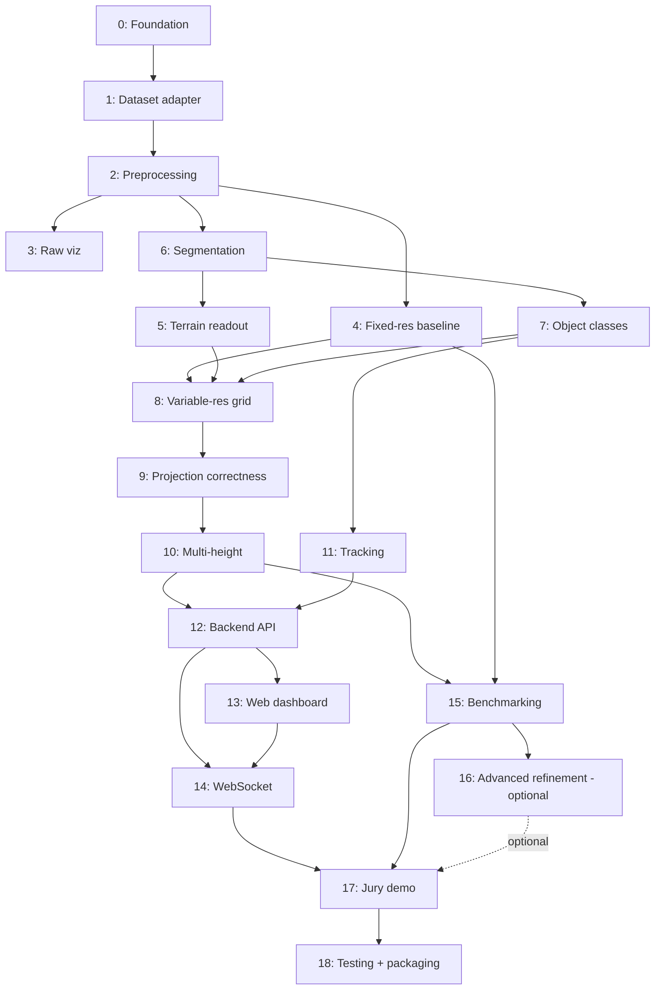

# PHASES.md
### FoveaLidar — build order

Ordered by technical dependency, not calendar time — there is no schedule in this file on purpose. A phase starts when its prerequisites are done, however long that took.

---

### Phase 0 — Project foundation & environment
- **Objective:** a repo that runs, does nothing yet.
- **Prerequisites:** none.
- **Inputs:** none.
- **Processing:** repo skeleton (`src/`, `notebooks/`, `frontend/`, `tests/`), `requirements.txt`, `.gitignore` (data/, artifacts/model/, *.db), config module stub.
- **Outputs:** an importable `src` package.
- **Files/modules:** `src/config.py`, `requirements.txt`, `.gitignore`.
- **Tests:** `import src` succeeds.
- **Acceptance criteria:** `pip install -r requirements.txt` then `python -c "import src"` both succeed on a clean environment.
- **Demo criteria:** none — internal only.
- **Risks:** none material.
- **Deliberately not yet:** everything else.

### Phase 1 — Dataset selection & ingestion
- **Objective:** a working `DatasetAdapter` interface with a runnable implementation that needs no download.
- **Prerequisites:** Phase 0.
- **Inputs:** none (synthetic) / nuScenes-mini or SemanticKITTI files (real, optional at this stage).
- **Processing:** define `DatasetAdapter.frames()`; implement `SyntheticAdapter`; implement `SemanticKittiAdapter` against the documented `.bin`/`.label` format (untestable here without the real files, but code-complete).
- **Outputs:** `RawFrame` objects flowing from either adapter.
- **Files/modules:** `src/data/base_adapter.py`, `src/data/synthetic_adapter.py`, `src/data/semantickitti_adapter.py`.
- **Tests:** `SyntheticAdapter` yields well-formed frames; `SemanticKittiAdapter` unit-tested against a tiny hand-built fixture mimicking the real binary layout.
- **Acceptance criteria:** the same downstream code can consume either adapter without an `if` statement outside `src/data`.
- **Demo criteria:** none yet.
- **Risks:** real dataset file/schema edge cases (nuScenes' token-linked tables; SemanticKITTI's label file length mismatches) only surface once real data is used — flagged, not solvable without the files.
- **Deliberately not yet:** class mapping (Phase 2), preprocessing filters.

### Phase 2 — Raw LiDAR processing
- **Objective:** clean, validated, range-cropped, class-mapped points.
- **Prerequisites:** Phase 1.
- **Inputs:** `RawFrame` from any adapter.
- **Processing:** drop NaN/invalid points, crop to `MAX_RANGE`, apply the active dataset's → project class mapping via its adapter-supplied `label_mapper()` (or pass through unmapped for the synthetic adapter).
- **Outputs:** a stream of points ready for segmentation.
- **Files/modules:** `src/data/class_mapping.py`, preprocessing functions in `src/data/base_adapter.py`.
- **Tests:** boundary case at exactly `MAX_RANGE`; a point with a raw label not present in the mapping table raises rather than silently becoming `unknown`.
- **Acceptance criteria:** feeding a frame with points beyond `MAX_RANGE` returns a frame with those points excluded and counted, not dropped invisibly.
- **Demo criteria:** none yet.
- **Risks:** an incomplete class-mapping table silently miscategorising a real class — mitigated by the "raise, don't default" test above, for both mapping tables.
- **Deliberately not yet:** segmentation model, grid engine.

### Phase 3 — Raw LiDAR visualization
- **Objective:** see the points before trusting anything built on top of them.
- **Prerequisites:** Phase 2.
- **Processing:** minimal frontend "Raw" view, plain points, no colour semantics yet.
- **Outputs:** a rendered point cloud in the browser.
- **Files/modules:** `frontend/` Raw view component.
- **Tests:** manual/visual at this phase.
- **Acceptance criteria:** a synthetic frame renders recognisably (terrain scatter + fixed obstacles visible as denser clusters).
- **Demo criteria:** could be shown standalone if needed, but isn't the headline.
- **Risks:** none material.
- **Deliberately not yet:** semantic colouring, grid overlay.

### Phase 4 — Fixed-resolution 2.5D baseline
- **Objective:** the uniform grid the whole project is benchmarked against, built *before* the adaptive version, deliberately — you cannot honestly claim a win over a baseline you haven't actually built and run.
- **Prerequisites:** Phase 2.
- **Processing:** single-band grid (one cell size, applied out to `MAX_RANGE`), same cell/key data structure the adaptive engine will use, just with one band instead of several.
- **Outputs:** a working, measurable uniform grid.
- **Files/modules:** `src/mapping/grid.py` (built generically enough that "one band" and "four bands" are the same code path — see Phase 8).
- **Tests:** cell count for a known synthetic frame matches the closed-form geometry calculation.
- **Acceptance criteria:** the uniform grid's cell count and memory estimate are what Phase 15's Compare view will show as the "before" number.
- **Demo criteria:** not shown alone.
- **Risks:** if this is built as genuinely separate code from the adaptive grid, the two can drift and the comparison stops being apples-to-apples — mitigated by using one `VariableResolutionGrid` class parameterised by a band list, where "uniform" is just a one-band list.
- **Deliberately not yet:** multiple bands, multi-height layers.

### Phase 5 — Terrain analysis
- **Objective:** drivable/non-drivable readout per point.
- **Prerequisites:** Phase 6 (needs classified points) — listed here per the brief's numbering, built after segmentation exists.
- **Processing:** map `drivable`/`non_drivable` classes to a terrain summary per cell.
- **Outputs:** terrain layer for the 2.5D view.
- **Files/modules:** terrain aggregation inside `src/mapping/grid.py` (a readout, not a separate model — ARCHITECTURE.md §8).
- **Tests:** a cell with only `drivable` points reports 100% drivable; mixed cells report the correct ratio.
- **Acceptance criteria:** terrain layer visibly distinguishes road from non-road in the demo scene.
- **Demo criteria:** part of the "Semantic" and "2.5D" views.
- **Risks:** flat-ground assumption in the heuristic placeholder won't hold on sloped real terrain — documented, not solved, in the MVP.
- **Deliberately not yet:** slope/roughness derivation (FUTURE).

### Phase 6 — Semantic segmentation
- **Objective:** every point gets a class + confidence, from something behind the fixed interface.
- **Prerequisites:** Phase 2.
- **Processing:** implement `HeuristicPlaceholder` first (Phase 6a); train a real model on Kaggle once the local preprocessing pipeline (notebooks 01–07) has produced a dataset (Phase 6b, can run in parallel with Phases 8–14 since it only needs the interface, not the grid).
- **Outputs:** `ClassifiedPoint` stream.
- **Files/modules:** `src/perception/model.py`, Kaggle training notebooks.
- **Tests:** `HeuristicPlaceholder` and any trained model both satisfy the same interface contract test.
- **Acceptance criteria:** swapping the model implementation requires zero changes outside `src/perception`.
- **Demo criteria:** "Semantic" view colours points by class.
- **Risks:** trained model too slow for live inference on demo hardware — mitigated by the Mode A (precomputed) / Mode B (live) split, PROJECT_REQUIREMENTS.md §17/19.
- **Deliberately not yet:** motion-aware classification (that's tracking, Phase 11, plus the ADVANCED refinement of Phase 16).

### Phase 7 — Object classification
- **Objective:** static-obstacle and dynamic-object classes distinguished and ready for the grid/tracker respectively.
- **Prerequisites:** Phase 6.
- **Processing:** class-mapping layer routes dataset-specific classes to the project taxonomy's `static_obstacle`/`dynamic_object`.
- **Outputs:** points correctly routed to the grid (static) or the tracker (dynamic) — see the architectural boundary in ARCHITECTURE.md §2.
- **Files/modules:** `src/data/class_mapping.py`.
- **Tests:** every class in the active dataset's taxonomy maps to exactly one project class; nothing maps to more than one — both `nuscenes_class_mapping.py` and `class_mapping.py` self-check this on import.
- **Acceptance criteria:** no dataset class is silently ignored — mapping table covers all of them, `unknown` included.
- **Demo criteria:** poles/walls visible as static obstacles in "Semantic"/"2.5D" views.
- **Risks:** none beyond Phase 6's.
- **Deliberately not yet:** bounding-box detection (explicitly out of scope, PROJECT_REQUIREMENTS.md §10).

### Phase 8 — Variable-resolution grid engine
- **Objective:** the actual novelty — a multi-band radial-hash grid.
- **Prerequisites:** Phases 4, 5, 7.
- **Processing:** extend Phase 4's single-band grid to N configurable bands; `(band, angle_bin, range_bin)` keying (ARCHITECTURE.md §10).
- **Outputs:** a working adaptive grid over the default 4-band config.
- **Files/modules:** `src/mapping/resolution_policy.py`, `src/mapping/grid.py`.
- **Tests:** cell count with 4 bands is meaningfully lower than Phase 4's 1-band baseline on the same frame; no cross-band key collisions (the specific regression test for the bug already found once — see RULES.md).
- **Acceptance criteria:** changing the band list in config changes cell count on the next run with no other code change.
- **Demo criteria:** "Adaptive Grid" view shows visibly different cell sizes by distance.
- **Risks:** this is where the collision bug lived; mitigated by the band-in-key design and its regression test.
- **Deliberately not yet:** multi-height layers (Phase 10), semantic/motion-aware refinement (Phase 16).

### Phase 9 — 3D → adaptive 2.5D projection correctness
- **Objective:** prove the projection has no seams, gaps, or misassigned points.
- **Prerequisites:** Phase 8.
- **Processing:** dedicated correctness tests at every band boundary, at `r=0`, at `r=MAX_RANGE`, and with points exactly on a boundary (both sides of the epsilon).
- **Outputs:** a projection stage trusted enough to build on.
- **Files/modules:** `tests/test_grid_boundaries.py`.
- **Tests:** the actual deliverable of this phase.
- **Acceptance criteria:** 100% of boundary test cases pass; a visualisation of a synthetic radial sweep shows no visible seam between bands.
- **Demo criteria:** the "no seams" claim is something a technical juror may ask to see — this phase is what makes the answer true.
- **Risks:** floating-point edge cases at a boundary — mitigated by testing both epsilon-below and epsilon-above every boundary explicitly, not just the boundary value itself.
- **Deliberately not yet:** none — this phase either passes or the project isn't ready for Phase 10.

### Phase 10 — Multi-height representation
- **Objective:** overhangs and multi-surface cells survive the projection.
- **Prerequisites:** Phase 9.
- **Processing:** height-tolerance merge logic, per-band layer cap, fold-into-nearest on cap overflow (ARCHITECTURE.md §12).
- **Outputs:** cells that can legitimately hold >1 layer.
- **Files/modules:** `src/mapping/grid.py` (`HeightLayer`, `GridCell.ingest`).
- **Tests:** a synthetic overhang (two points, same `(angle,range)`, different height, in the same band) produces two layers; a third point beyond the band's cap folds into the nearest layer rather than being dropped.
- **Acceptance criteria:** PROJECT_REQUIREMENTS.md §26's "at least one cell has >1 height layer" criterion passes.
- **Demo criteria:** cell inspector (Phase 13) on that specific cell visibly shows two layers.
- **Risks:** merge-tolerance value is a judgement call, not derived — documented as a tuned parameter in config, not a claimed constant.
- **Deliberately not yet:** unbounded layers (deliberately capped per band, by design).

### Phase 11 — Dynamic-object tracking
- **Objective:** stable IDs across frames for `dynamic_object` detections.
- **Prerequisites:** Phase 7.
- **Processing:** greedy nearest-neighbour association, gating radius, miss-tolerance window before a track drops.
- **Outputs:** a live `Track` list per frame.
- **Files/modules:** `src/tracking/tracker.py`.
- **Tests:** an object moving in a straight line keeps one ID across N frames; two objects that cross paths don't swap IDs at the crossing (documented as a known limitation of greedy NN if it fails — Hungarian assignment is the upgrade path, not required for MVP).
- **Acceptance criteria:** a track's `age` increments correctly across consecutive matched frames.
- **Demo criteria:** dynamic objects in the dashboard show a persistent ID as they move, including across a resolution-band boundary.
- **Risks:** greedy NN is a known-simple baseline; documented as such rather than oversold.
- **Deliberately not yet:** Kalman filtering, Hungarian assignment (both are drop-in upgrades behind the same `update()` method).

### Phase 12 — Backend API
- **Objective:** REST endpoints for stats and benchmark runs.
- **Prerequisites:** Phases 10, 11.
- **Processing:** `GET /api/stats`, `GET /api/benchmark/run`, SQLite persistence wiring.
- **Outputs:** a running FastAPI app answering both endpoints correctly.
- **Files/modules:** `src/api/main.py`, `src/storage/db.py`, `src/storage/schema.sql`.
- **Tests:** `TestClient` hits both endpoints; `benchmark/run` produces a row in `benchmark_runs`.
- **Acceptance criteria:** restarting the server and re-querying `/api/stats` returns the same geometry-derived numbers (determinism check).
- **Demo criteria:** not shown directly — the frontend is the interface.
- **Risks:** none material.
- **Deliberately not yet:** the WebSocket (Phase 14).

### Phase 13 — Web dashboard
- **Objective:** the five-view dashboard.
- **Prerequisites:** Phase 12.
- **Processing:** Raw / Semantic / 2.5D / Adaptive Grid / Compare views, cell-click inspector.
- **Outputs:** the primary jury-facing artifact.
- **Files/modules:** `frontend/`.
- **Tests:** component-level rendering checks; manual visual QA against PROJECT_REQUIREMENTS.md §13.
- **Acceptance criteria:** every field listed in PROJECT_REQUIREMENTS.md's cell-inspection example is present and populated for a real clicked cell.
- **Demo criteria:** this *is* the demo, alongside Phase 17's rehearsed flow.
- **Risks:** UI complexity growing past what a jury can parse in the allotted time — mitigated by defaulting to the jury-friendly headline numbers with technical detail one click away, never the reverse.
- **Deliberately not yet:** live WebSocket updates (Phase 14 — this phase can ship against REST/poll first).

### Phase 14 — Real-time / WebSocket integration
- **Objective:** the dashboard updates live instead of on request.
- **Prerequisites:** Phases 12, 13.
- **Processing:** `WS /ws/frames`, frontend WS client feeding the shared React state.
- **Outputs:** visibly live dashboard.
- **Files/modules:** `src/api/main.py` (WS handler), `frontend/` WS client.
- **Tests:** a disconnect/reconnect doesn't corrupt state; message schema version is checked client-side.
- **Acceptance criteria:** ≥5 updates/sec sustained on the synthetic path (NFR4).
- **Demo criteria:** this is what makes the demo read as "live" rather than "a slideshow."
- **Risks:** WS instability on unfamiliar jury-venue wifi — mitigated by Phase 17's recorded-backup requirement.
- **Deliberately not yet:** none.

### Phase 15 — Uniform vs. adaptive benchmarking
- **Objective:** the actual measured numbers the whole pitch rests on.
- **Prerequisites:** Phases 4, 10.
- **Processing:** run both grid modes on the same frame, time both, persist both.
- **Outputs:** a `benchmark_runs` pair (uniform, adaptive) with real numbers.
- **Files/modules:** `src/evaluation/benchmark.py`.
- **Tests:** the measured cell-count numbers match the closed-form geometry estimate within expected variance; latency is >0 and repeatable within a tolerance across repeated runs.
- **Acceptance criteria:** PROJECT_REQUIREMENTS.md §26's benchmark acceptance criteria pass in full.
- **Demo criteria:** the Compare view's headline numbers, live, not screenshotted.
- **Risks:** a slow dev machine making the absolute numbers look unimpressive — mitigated by leading with the relative compression ratio (machine-independent) alongside the absolute figures.
- **Deliberately not yet:** per-band accuracy (needs a trained model + labelled validation data — folds in once Phase 6b completes).

### Phase 16 — Advanced adaptive refinement (ADVANCED, optional)
- **Objective:** extend the resolution policy from distance-only to distance+semantics/uncertainty/motion.
- **Prerequisites:** Phase 15 passing in full — this phase does not start before the MVP claim is already proven.
- **Processing:** an additional, toggleable refinement pass; distance-only policy must remain selectable and remain the default.
- **Outputs:** a second, clearly-separated claim (PROJECT_REQUIREMENTS.md §23).
- **Files/modules:** a new `src/mapping/refinement.py`, never modifying `resolution_policy.py`'s distance-only path in place.
- **Tests:** toggling refinement off reproduces Phase 15's exact numbers.
- **Acceptance criteria:** the MVP demo still works, unchanged, with refinement off.
- **Demo criteria:** shown only as "and here's what's possible next," never as the headline.
- **Risks:** scope creep displacing MVP polish — mitigated by the hard prerequisite above.
- **Deliberately not yet:** N/A — this phase is itself the "not yet" for the rest of the project until Phase 15 is solid.

### Phase 17 — Jury demonstration
- **Objective:** a rehearsed, hardware-optional demo flow.
- **Prerequisites:** Phases 14, 15 (16 optional).
- **Processing:** scenario selection UI, rehearsed narrative script, a recorded backup video.
- **Outputs:** the actual pitch flow.
- **Files/modules:** demo scenario configs, a recorded screen-capture backup.
- **Tests:** a full dry run, timed, on the actual demo machine and network.
- **Acceptance criteria:** the demo completes end-to-end offline, from the synthetic adapter or a pre-selected sequence, with no manual intervention.
- **Demo criteria:** this phase *is* the criteria.
- **Risks:** live sensors/wifi failing in front of the jury — mitigated by the recorded backup and the offline-capable synthetic path.
- **Deliberately not yet:** N/A.

### Phase 18 — Testing, optimization, final packaging
- **Objective:** everything from Phases 0–17 hardened.
- **Prerequisites:** Phase 17.
- **Processing:** full test suite green, dependency pins finalised, README finalised, docs cross-checked against actual code (RULES.md's documentation rule).
- **Outputs:** a repository someone outside the team could clone and run from README alone.
- **Files/modules:** all.
- **Tests:** full suite, plus a clean-clone smoke test.
- **Acceptance criteria:** PROJECT_REQUIREMENTS.md §26, in full, on a machine that didn't build the project.
- **Demo criteria:** N/A — this is the state the project is in *during* Phase 17, verified once more after.
- **Risks:** none beyond accumulated risk from earlier phases.
- **Deliberately not yet:** everything in PROJECT_REQUIREMENTS.md §22 (future work) — by design, forever, until someone deliberately starts a new phase list for it.

---

## Dependency graph

## MVP boundary

Phases 0–15 + 17 + 18. That is: everything through measured benchmarking and the jury demo, on a distance-only resolution policy. This is the full official SIH26053 claim.

## Advanced-feature boundary

Phase 16 only, strictly after Phase 15 passes, strictly optional, strictly toggleable back to the MVP behaviour.

## Recommended first implementation step

Phase 0, immediately followed by Phase 1's `SyntheticAdapter` — everything downstream (Phases 2–15) can be built and fully tested against synthetic data alone, with zero dependency on any real dataset download completing first. Start the nuScenes-mini download and Jupyter exploration (notebooks 01–02) in parallel, not on the critical path.

## Major technical risks

1. The band-collision class of bug (Phase 8/9) — already found once in this project's own history; the regression test in Phase 9 is the safeguard, not a promise it can't recur in a different form.
2. Trained-model latency on demo hardware (Phase 6b/17) — the Mode A/B split is the mitigation, decided in Phase 6, not improvised at Phase 17.
3. Greedy-NN tracker ID swaps at path crossings (Phase 11) — acceptable for MVP, documented, with a named upgrade path.
4. Jury-venue network reliability (Phase 17) — mitigated by the offline synthetic path and a recorded backup, not by hoping the venue wifi holds.

## Questions to resolve before coding starts

1. Height-merge tolerance for multi-layer cells (Phase 10) — a tuned value; what's the first guess, and what test scene will validate it?
2. Whether nuScenes-mini's full 10 scenes are sufficient as-is (it's small enough to skip sequence-staging entirely — see `notebooks/local/04_preprocessing.ipynb`), or whether the SemanticKITTI alternative's Stage A/B/C/D subsetting (Document 2) is needed after all — decide once notebook 05's statistics are in.
3. Target demo hardware for Phase 17 — decided before Phase 6b's model-selection tradeoff (accuracy vs. latency) can actually be made.
4. Whether Phase 16 is attempted at all this cycle, or written up as future work only — affects whether `src/mapping/refinement.py` is scaffolded now or later.
